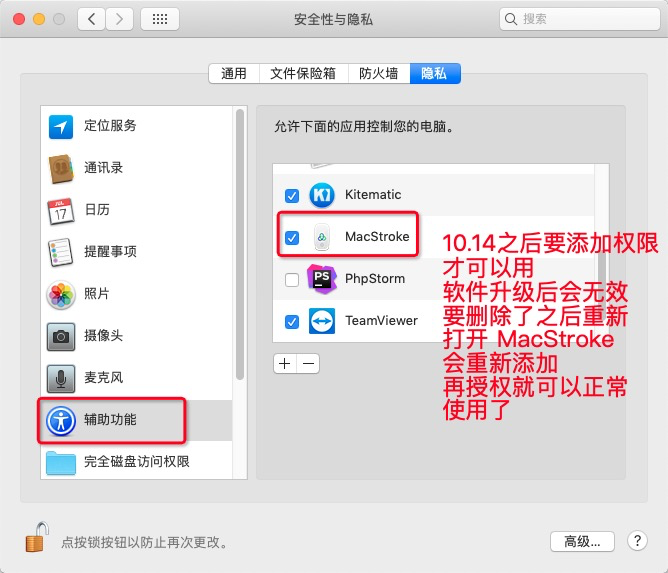
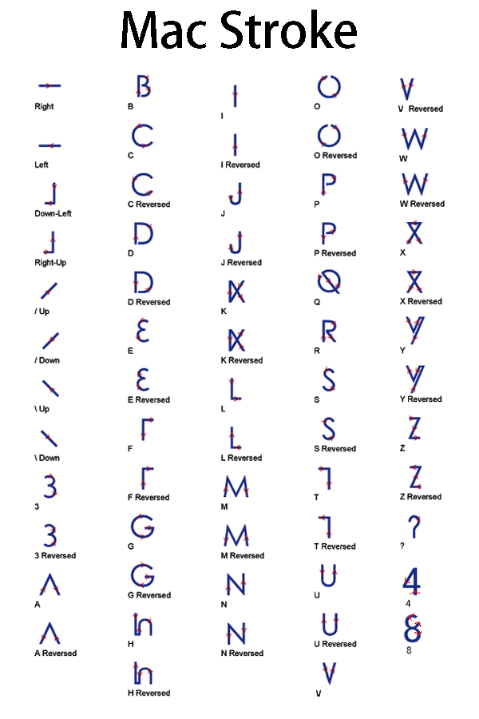
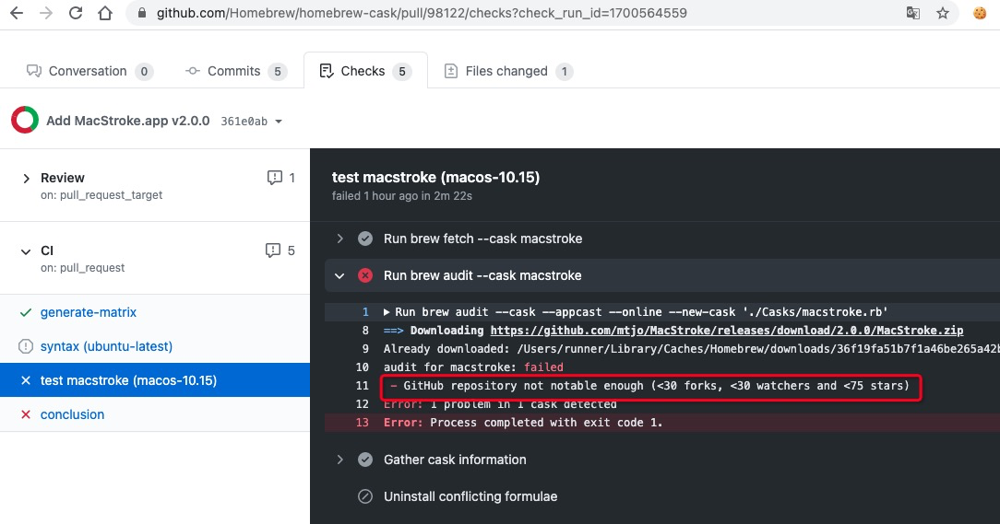

MacStroke
================================
[English Version](https://github.com/mtjo/MacStroke/blob/main/README_en.md)


macOS上一款高度可配置的全局鼠标手势软件。
===
>MacStroke是MacOS的手势识别应用程序。 手势是在按住特定鼠标按钮的同时使用鼠标进行的运动。 如果手势被识别，MacStroke将执行某些操作。
>目前MacStroke可以模拟按键与快捷键、输入文本或密码、执行 apple script、按坐标点击、复制进粘贴板、弹出截图、调系统音量；3.x 还带历史粘贴板、远程控制、截图/录屏、蓝牙靠近锁屏、划词气泡。MacStroke尝试提供直观和高效的用户界面，同时具有高度可配置性并提供许多高级功能。

## 版本与系统支持

| 版本 | 源码分支 | 系统要求 | 状态 |
| --- | --- | --- | --- |
| **3.0.0 及以后**（当前 **3.2.5**） | [`main`](https://github.com/mtjo/MacStroke/tree/main)（Swift 重写） | **macOS 13 Ventura 或更新** | 当前维护线。通用二进制（Apple Silicon 原生 + Intel），界面与操作与原版保持一致 |
| 2.0.5 及更早 | [`master`](https://github.com/mtjo/MacStroke/tree/master) / `release`（Objective-C） | macOS 10.10 及以上 | 停止维护，仅作为老系统的兜底版本 |

- **旧版可以直接升级：** 2.0.5 及更早版本在软件内「检查更新」就能升到 3.0.0，走的是同一条 appcast（更新条目同时带 Sparkle 1.x 的 DSA 签名和 Sparkle 2 的 EdDSA 签名）。规则、AppleScript、历史粘贴板等数据沿用同一份，不需要迁移。
- **低于 macOS 13 收不到升级：** 更新条目声明了 `minimumSystemVersion 13.0`，macOS 12 及更老的机器会一直停在 2.0.5。需要新功能的机器请先升级系统。
- **升级后请重新勾选辅助功能：** 换到 Swift 版后二进制换了身份，系统可能要求重新授权（见下）。
- 版本号只在 [`build_app.sh`](build_app.sh) 顶部的 `APP_VERSION` 里维护，打包、appcast 条目、更新说明页都从这一处取。逐版改写在 [`Changelog/`](Changelog) 里（中英双语）。

> 从源码构建时，Swift 版需要 macOS 13 及以上的部署目标（`Package.swift` 里的 `.macOS(.v13)`），Sparkle 这个依赖本身要求 macOS 12 及以上。

## 权限

### 10.14系统后就要添加权限 设置->安全性与隐私->隐私->辅助功能 这个必须的, 才能正常使用



### 「屏幕录制」只有用到这两个功能才需要授权：远程控制的小屏回显、以及截图/录屏

系统只会主动问一次，点过「不允许」之后它不再弹框、而是静默给一张只有壁纸的图，看起来像功能坏了。所以这两条路径会自己检查，没授权时直接给一个跳到「隐私与安全性 → 屏幕录制」的按钮；授权后需要重启一次应用才生效。纯手势功能不需要这个权限。

截图遮罩顶上那条模式条有四档：截图、滚动截图、录屏、提取文字。滚动截图和录屏要把屏幕还给被操作的那个 App，所以选区一落定遮罩就收掉，只留一圈描边和一枚控制胶囊（这两扇浮层都不进采集，不会出现在成片里）；长截图靠往选区中心注入滚轮翻页，录屏走 AVCaptureScreenInput 区域采集出 MP4，都没有声音。

画上去的箭头、方框、文字都能回头改：按在哪一条上就是改哪一条（四颗角和边上的把手改大小，按住本体整条挪，Delete 删这一条），不用先把工具摘掉；刚画完那一笔本身也是选中态。选中某一格工具会在它上方浮出属性面板，七档预设色加一枚自定义取色，每格工具各记自己那套粗细和颜色（箭头要粗、框要细不必每画一笔重调），文字另有字号、粗体、斜体、边框和底衬。这套值只活在这次截图里，关掉遮罩就回到红加默认粗细。双击已经写好的字是把输入框盖回原字上改内容，位置字号不动。

### 「蓝牙」只在靠近锁屏那一页用到

第一次点「扫描设备」会弹系统蓝牙授权；自动解锁还要「辅助功能」（只给「输入监控」不够）。总开关开着但没选设备时不算武装，程序连蓝牙中心都不构造，也就不会多要这一项权限。远程控制不新增任何隐私声明（随包的 Info.plist 里只有蓝牙那一条）：它只是在本机监听一个端口，界面上给出本机地址与配对二维码，不经过任何服务器；这一页里只有小屏回显吃上面说的「屏幕录制」。

### 软件多次升级对旧版数据可能会出现不兼容而闪退，如果遇程序闪退，请清除旧数据重新打开，操作： 常规->重置到预设，然后手动退出程序再打开，或者删除 ~/Library/Preferences/net.mtjo.MacStroke.plist 重新打开软件

###  预设手势说明



## 这一版都有什么（按偏好设置左侧那 12 页排）

原版那 8 页的行为与界面都保持原样，多出来的 4 页是移植版新增，全部默认关 —— 关掉时连监听都不挂，识别耗时和延迟与没做这些功能之前一致。

| 页 | 管什么 | 从哪版起 |
| --- | --- | --- |
| 常规 | 起手键（默认右键，可改中键/侧键/自定义键）、灵敏度、抬手响应、「让位修饰键」（按住指定的修饰键期间手势暂停，敲快捷键不误触发）、提示样式、导入/导出、重置到预设 | 3.0.0，3.1.x |
| 规则 | 每条手势配一个动作：快捷键、按键/文本/密码输入、AppleScript、按坐标点击、复制进粘贴板、弹出截图、音量 ±1 档；可按应用配（filter），预设手势图标网格直接选；双击快捷键格弹出一块 Mac 键盘，点修饰键再点主键即可（键盘表里没有的键点「改成手写…」直接写 ⌃⌥⇧⌘ 加键名）；「绘制手势」面板底下多一栏「瞬时手势（不用画）」 —— 上滚/下滚（按住起手键滚一格）、中键、后退、前进各是一档手势，不用画轨迹；同一颗键若同时是起手键，起手键优先，偏好页会给出提示 | 3.0.0，3.2.4 |
| 过滤 | 黑名单/白名单，每行一个软件；哪些软件整个不吃手势 | 3.0.0，3.2.3 修好重启丢名单 |
| AppleScript | 脚本列表与迁移、`sdef` 被外部调用（`openPreferences` 等） | 3.0.0 |
| 模拟右键 | 原版那一页：一列 bundle ID，支持 `*` 通配（如 `com.jetbrains.*`）。名单里的应用里按下起手键却没拖动、又没命中任何规则时，MacStroke 合成一次 Ctrl+左键，把那家的原生右键菜单叫出来；不在名单里的应用只原样回放那颗按键 | 3.0.0 |
| 右键增强 | 主开关加三项子开关（新建文本文件、在终端打开 Terminal/iTerm、复制文件路径），随包的 Finder Sync 扩展读的就是这份；下面另挂一节「手势打到光标下的窗口」（3.2.2，默认关；开着时松手压在谁家的窗上就按那家匹配、快捷键和文本也投给那家，可选投完把焦点还回去；关着时压根不抓在屏窗口表）。这一页原先那节「按住起手键 + 滚轮」在 3.2.4 删掉了：滚轮整并进规则表，在规则页「瞬时手势」里给上滚/下滚（以及中键、侧键）配动作，可以按应用分、可以跑 AppleScript；升级时如果旧的两档当年真开着，会自动转成两条滚轮规则各一次，转完旧设置不再参与匹配 —— 没配过规则的人滚轮照旧归前台应用，一格都不会被吞 | 3.0.0，3.2.1，3.2.2，3.2.4 |
| 剪贴板 | 历史条目（含图片与文件条目）、去重与置顶、保留条数与清理 | 3.0.0，3.1.x |
| 远程控制 | 同一局域网里用手机遥控这台 Mac：小程序的触屏回显、点按拖拽、键盘与快捷键、滚轮。页面上给本机地址、配对二维码与小程序码 | 3.1.0～3.1.3 |
| 截图/录屏 | 保存位置、默认快捷键（⌘⇧A）、放大镜倍率、模式条四档（截图/滚动截图/录屏/提取文字）、注解工具与就地编辑、Vision 文字识别；3.2.4 起遮罩收掉（或存盘面板关掉）后把焦点交还给按快捷键前那家应用，主程序不再留在前台；同一版修掉提示气泡的排版 —— 带完整文件名的「已保存 …png」不再把字顶出黑框（框宽不冲破上限、折行用的宽度就是文字真正拿到的宽度、框高按行数给足）；3.2.5 起吸附时可把光标下那扇被压住的窗提到最前并重拍冻结帧（默认关；提窗只借一下前台，抓完立刻收回遮罩） | 3.1.4～3.1.9，3.2.4，3.2.5 |
| 靠近锁屏 | 戴的蓝牙设备就是钥匙：人走开锁屏，人回来可自动解锁（密码存本机钥匙串，默认关）。在不在旁边按双阈值滞回判定，差值、撑秒数、丢设备时限都能调 | 3.1.7 |
| 划词气泡 | 选中一段字弹一枚四格胶囊：复制、搜索、翻译、朗读。两条触发（左键划完松手 / 默认 ⌃⌘B 叫出当前焦点的选区）；「搜索走哪家」可配（6 家引擎 + 8 家网页 AI + 自定义 URL 模板）；没有无障碍出口的软件（邮件正文）可代按一次 ⌘C 取字；打不进 URL 的页面可开「打开后自动贴一次 ⌘V」 | 3.2.0 |
| 关于 | 版本、检查更新节奏与温和提醒、「已跳过的版本」与恢复提醒 | 3.0.0，3.1.2～3.1.3，3.2.1 修 |

状态栏菜单是：偏好设置、剪贴板（直接弹出历史面板，不跳到偏好窗口）、截图/录屏（直接摊开遮罩）、远程控制（落到那一页）、检查更新、退出；后台发现了新版本会在最上面多一枚「发现新版本：x.y.z」，点它才把更新窗拉到前面。剪贴板、截图/录屏、远程控制、检查更新这四入口都是移植版自加的（原版那一条只有偏好设置和退出）。Finder 的右键菜单项由随包的 Finder Sync 扩展提供，读的就是「右键增强」那一页的开关。更新走 Sparkle，更新条目同时带 DSA 与 EdDSA 两份签名，所以 2.0.5 也能收得到 3.x。

## 致谢

3.2.4 的四项改动全部来自用户提的具体建议：截图后主程序不该跳到前台、滚轮也能像轨迹一样配规则、录不到的组合键要能当场点出来、音量档该进规则动作 —— 感谢 [@lqscript](https://github.com/lqscript)（[issue #78](https://github.com/mtjo/MacStroke/issues/78)）。其中滚轮那一条是接着 [issue #75](https://github.com/mtjo/MacStroke/issues/75)「右键 + 滚轮」那一版做的，感谢 [@DemoJameson](https://github.com/DemoJameson) 提的需求，以及后来那份 fork 里逐条指出的坑（对照结论在 [docs/wheel-gesture-issue75.md](docs/wheel-gesture-issue75.md)）。同一版还按实测反馈修掉两处：提示气泡遇到带完整文件名的长消息把字顶出黑框，以及在别的 App 里双击快捷键格那一下（窗口还没成为键窗）会把现有快捷键默默重写一遍。

3.2.5 的截图提窗同样来自实测反馈：开了吸附以后，被别的窗压住的那扇只能截到露着的一半。这一版让它跟着吸附框走，落到哪扇提哪扇、提完重拍，验收后按用户要求把这一档默认关（提窗会切一下前台，不替新装用户做这一手）。完整账目见 [docs/screenshot-raise-window.md](docs/screenshot-raise-window.md)。

## 下载安装

安装包下载：[MacStroke](https://github.com/mtjo/MacStroke/releases/latest)

homebrew 安装
```
brew tap mtjo/tap
brew install --cask mtjo/tap/macstroke
```

> 必须写完整的 token `mtjo/tap/macstroke`。官方 homebrew-cask 里同名的 `macstroke` 已在 2026-09-01 被标记为 `disable! date: "2026-09-01", because: :fails_gatekeeper_check`（发布包用的是自签名证书，`spctl` 判定过不了 Gatekeeper），版本还停在 2.0.5，所以 `brew install --cask macstroke` 只会报「已被禁用」。自己的 tap 不受这条限制。
>
> 首次启动仍会被 Gatekeeper 拦一次（自签名，无 Developer ID）：右键应用 →「打开」，或者 `xattr -dr com.apple.quarantine /Applications/MacStroke.app`。
>
> 想恢复官方 cask：给发布包换成 Developer ID 签名 + 公证（notarization），再向 homebrew-cask 提 PR 把版本升到当前版并去掉 `disable!`。装完后记得手动开辅助功能（见上面「权限」）。

### 反馈
[反馈BUG&建义](https://github.com/mtjo/MacStroke/issues)

### 软件实用的话就分享给你的亲朋好友,顺便帮点一下 star 和 fork (把软件发到 homebrew 有硬性要求)
### 软件实用的话就分享给你的亲朋好友,顺便帮点一下 star 和 fork (把软件发到 homebrew 有硬性要求)
### 软件实用的话就分享给你的亲朋好友,顺便帮点一下 star 和 fork (把软件发到 homebrew 有硬性要求)


Power by [](http://mtjo.net)

---

## 源码与构建（Swift 版）

- Swift 5.9+，Swift Package Manager，SwiftUI + AppKit 混合 UI，SQLite.swift 持久化
- 事件层是 CGEventTap：手势捕获一条，滚轮那档另开一条（建出来就禁用，只在起手键按着的那段上膛）；注入一律走 session 层
- 识别是 DTW 模板匹配，动作查规则表，规则可按应用（bundleID）过滤

```bash
swift build            # 编译
swift test             # 单元测试（各模块有同名 *Tests 目标，需要带 XCTest 的工具链）
python3 tools/xctstub/xct.py regress   # 本机工具链不带 XCTest（2026-10-22 起），跑全部 11 套用这套桩件
python3 tools/mutation/mutate.py tools/mutation/issue78.json   # 反向变异：逐条把坏法塞回源码，看判据咬不咬得住
./build_app.sh         # 打出 MacStroke.app（通用二进制 + 内嵌 Sparkle + Finder 扩展）
./make_release.sh      # 生成发版用 zip 与双签 appcast 条目（release_out/）
```

```
Sources/
  GestureEngine/       # Stroke / GesturePoint / GestureMatcher (DTW) / 预设手势 / InstantGesture（瞬时手势：滚轮 / 中键 / 侧键）/ KeyboardShortcutText（快捷键串 ↔ 键码）
  EventCapture/        # CGEventTap 全局捕获、滚轮读数与节流
  RuleEngine/          # Rule / RuleAction / ActionExecutor / 瞬时规则匹配 / 旧滚轮设置迁移
  Storage/             # PreferencesStorage / HistoryClipboard / 本地化
  Preferences/         # SwiftUI 偏好页面
  WindowManager/       # ToastManager / WindowManager / 快捷键录入框
  AppleScriptRunner/   # AppleScript 执行器与脚本列表
  RemoteControl/       # 局域网 TCP 服务、点击/键盘/滚轮合成、屏幕采集推流
  Screenshot/          # 冻结帧抓取、选区遮罩、注解模型与合成、滚动截图、录屏、OCR、吸附提窗
  ProximityLock/       # 蓝牙在场判定状态机、锁屏与注入解锁
  SelectionPopup/      # 取选中文字（Accessibility，带几条回退读法）、四格气泡
  RightClickMenu/      # 右键菜单构建
  FinderSyncExtension/ # Finder 右键菜单扩展
  MacStrokeApp/        # 应用入口与接线
Tests/                 # 各模块同名单元测试
tools/xctstub/         # 离线用例执行器：本机 Command Line Tools 2026-10-22 起不带 XCTest，跑用例走这套桩件
tools/mutation/        # 反向变异执行器与逐轮变异表（把判据咬不住哪种坏法记进 docs/ 台账）
docs/                  # 发版与取证台账（签名、issue #22/#75/#76/#78、截图提窗、划词气泡、靠近锁屏交接）
```

本地开发与自签名证书的说明见 [docs/signing.md](docs/signing.md)。
